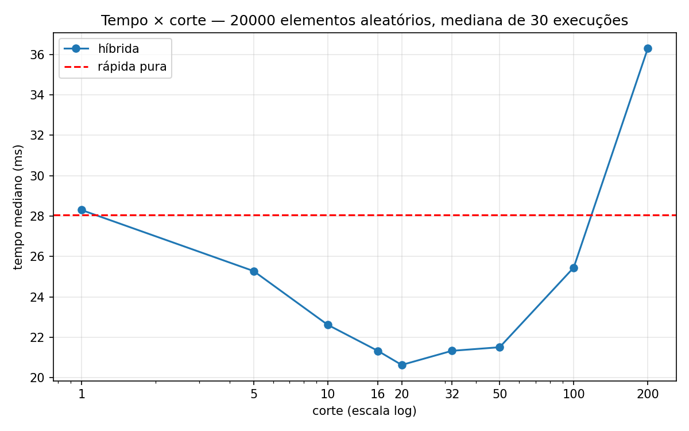

# RELATÓRIO — Quicksort híbrida (rápida + inserção)

## Implementação

Arquivo: `ordenacao_hibrida.py` (Python 3).

- `rapida(v)`: quicksort com **pivô aleatório** (`random.choice`) que separa a lista em **menores, iguais e maiores**; recursão só nos menores e maiores (os iguais já estão no lugar, o que protege contra muitos elementos repetidos).
- `hibrida(v, corte)`: igual à anterior, mas quando o pedaço tem **menos que `corte` elementos** chama `insercao(v)`. O `corte` é parâmetro da função.
- `insercao(v)`: ordenação por inserção simples.

## Metodologia

- Entrada: **20.000 inteiros aleatórios**; **30 listas diferentes** (semente 42), as mesmas para todos os métodos.
- Cortes testados: 1, 5, 10, 16, 20, 32, 50, 100 e 200, além da rápida pura.
- Para cada lista, todos os métodos rodam **intercalados** (reduz o efeito de ruído/deriva da máquina) e com a **mesma semente de pivôs**.
- Métrica: **mediana** dos 30 tempos (`time.perf_counter`). Todas as saídas são conferidas contra `sorted()`.
- Reprodução: `python3 ordenacao_hibrida.py` (gera `resultados.csv` e `grafico_tempo_corte.png`).

## Resultados

| corte | mediana (ms) | desvio-padrão (ms) | ganho sobre a pura |
|---:|---:|---:|---:|
| rápida pura | 28.07 | — | — |
| 1 | 28.30 | 3.67 | -0.8% |
| 5 | 25.28 | 3.92 | +9.9% |
| 10 | 22.62 | 3.83 | +19.4% |
| 16 | 21.33 | 2.87 | +24.0% |
| 20 | 20.63 | 3.20 | +26.5% |
| 32 | 21.33 | 2.09 | +24.0% |
| 50 | 21.51 | 2.44 | +23.4% |
| 100 | 25.45 | 4.34 | +9.3% |
| 200 | 36.30 | 6.72 | -29.3% |

## Análise

**Melhor corte.** O menor tempo mediano foi com **corte = 20**: **20,63 ms contra 28,07 ms da rápida pura**, um ganho de cerca de **26,5%** (a pura leva ~1,36× o tempo). Porém, o desvio-padrão (2–4 ms) é maior que a diferença entre os cortes de 16 a 50, então eles são **praticamente empatados**: a faixa boa é de **~16 a ~50**, e o 20 é só o mínimo desta medição. Isso concorda com o que bibliotecas reais usam (valores entre ~10 e ~32).

**Por que ajuda.** Nos pedaços pequenos, a inserção evita o custo fixo da recursão do quicksort (chamadas de função, `random.choice`, três varreduras para montar as listas de menores/iguais/maiores e a concatenação). Com `corte = 20`, a inserção foi chamada ~1.700 vezes em uma lista de 20 mil, eliminando as camadas mais baixas da árvore de recursão, que são as mais numerosas.

**Cortes grandes demais.** A curva tem formato de "U". A partir de ~100 o ganho cai (+9,3%) e com **corte = 200 a híbrida fica 29% mais lenta que a pura** (36,30 ms). A inserção é O(k²) por pedaço de tamanho k: quando o pedaço passa de algumas dezenas de elementos, o custo quadrático (deslocamentos de elementos) supera a economia de recursão do quicksort, que é O(k log k). No limite, `corte ≥ n` vira inserção pura, O(n²).

**Corte = 1 equivale à rápida pura.** Com `corte = 1`, a condição `len(v) < 1` nunca é verdadeira, pois pedaços de 0 ou 1 elemento já retornam antes no caso-base `len(v) <= 1`. Verificado: com a mesma semente, a saída é idêntica à da pura e a **inserção foi chamada 0 vezes**. A diferença medida (28,30 ms contra 28,07 ms, −0,8%) é ruído de medição, bem abaixo do desvio-padrão (~3,7 ms).

## Ressalvas

- Os tempos absolutos dependem da máquina e do Python; o que se espera que se mantenha é o **formato da curva** e a **região do ponto ótimo**. Em linguagens compiladas (C, Java), a inserção é proporcionalmente mais barata e o ponto ótimo costuma se deslocar um pouco.
- Esta versão cria listas novas a cada nível (não é in-place), o que aumenta o custo da recursão e favorece um pouco a troca para inserção.
